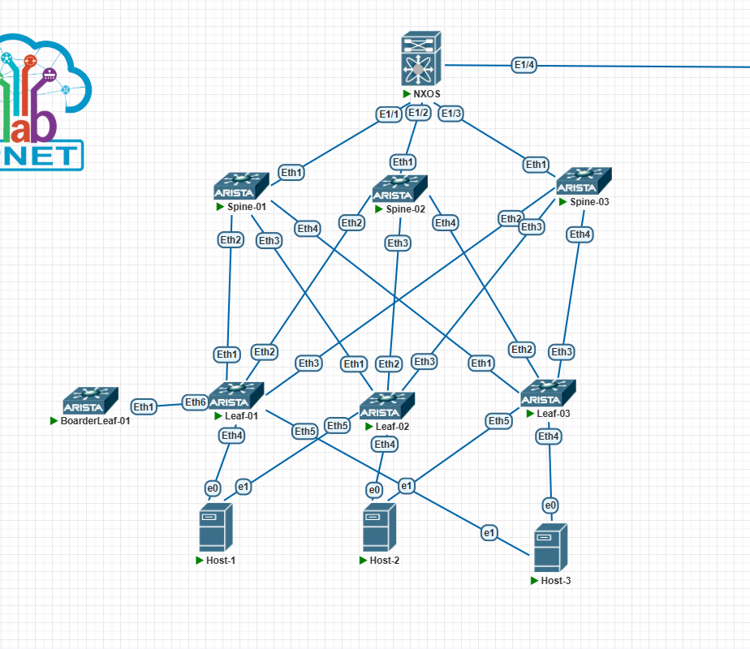

# Проектная работа. Сетевая фабрика на основе VXLAN EVPN

**Курс:** Дизайн сетей ЦОД  
**Студент:** Печерский Владимир  

---

## 1. Цель и задачи проекта

### 1.1. Цель

Спроектировать и реализовать сетевую фабрику ЦОД на основе Overlay-технологии **VXLAN EVPN**, обеспечивающую:
- **L2-связанность** клиентов, подключённых к разным Leaf-коммутаторам.
- **L3-маршрутизацию** между клиентскими сетями (VRF).
- **Multi-homing** клиентов через **ESI-LAG** (функциональный аналог vPC).
- **Выход во внешнюю сеть** через **BorderLeaf-01**.

### 1.2. Задачи

1. Спроектировать топологию фабрики CLOS (Super-Spine + Spine + Leaf + BorderLeaf).
2. Настроить **Underlay** на основе **eBGP** с BFD и MD5-аутентификацией.
3. Настроить **Overlay** на основе **VXLAN EVPN**:
   - **L2 VNI** — для растягивания клиентских VLAN.
   - **L3 VNI** — для маршрутизации между VRF.
   - **EVPN Type-2, Type-3, Type-5** — для обмена MAC/IP и IP-префиксами.
4. Настроить **ESI-LAG (vPC)** для multi-homing клиентов к двум Leaf.
5. Настроить **маршрутизацию между VRF**:
   - Основной сценарий: **через BorderLeaf-01** (внешнее устройство).
   - Альтернативный сценарий: **через Route Leaking** (внутри фабрики).
6. Проверить **отказоустойчивость** на всех уровнях.
7. Подготовить **презентацию** для защиты проекта.

---

## 2. Обоснование выбора решений

### 2.1. Почему VXLAN EVPN?

| Критерий | VXLAN EVPN | Традиционный L2 (STP) | Традиционный L3 |
|:---|:---|:---|:---|
| **Масштабируемость** | До 16 млн VNI | Ограничена STP | Ограничена |
| **Multi-tenancy** | VRF + VNI | VLAN (4096) | VRF |
| **Multi-homing** | ESI-LAG / vPC | STP (медленно) | Нет |
| **Автоматизация** | EVPN (control plane) | Ручная | Ручная |
| **ECMP** | Да (через Underlay) | Нет (STP блокирует) | Да |

**Вывод:** VXLAN EVPN — стандарт де-факто для современных ЦОД (RFC 8365, RFC 7938).

### 2.2. Почему eBGP в Underlay?

| Протокол | Плюсы | Минусы |
|:---|:---|:---|
| **OSPF** | Простота | Плохо масштабируется, нет Address Family |
| **IS-IS** | Масштабируемость | Сложная настройка, реже используется в ЦОД |
| **eBGP** | ✅ Масштабируемость, ✅ ECMP, ✅ Address Family, ✅ Гибкие политики | Требует больше настройки |

**Вывод:** eBGP — стандарт для Underlay в CLOS-фабриках (RFC 7938). Позволяет использовать **ECMP** (до 3 путей через Spine) и **Dynamic Neighbors** (упрощает добавление новых Leaf).

### 2.3. Почему ESI-LAG (а не классический vPC)?

**vPC (Virtual Port Channel)** — технология **Cisco Nexus**.  
**ESI-LAG (Ethernet Segment Identifier LAG)** — стандартизированный **EVPN multi-homing** (RFC 7432).

| Критерий | vPC | ESI-LAG |
|:---|:---|:---|
| **Вендор** | Только Cisco | Все вендоры (Arista, Cisco, Juniper) |
| **Control Plane** | Proprietary | EVPN (стандарт) |
| **Масштабируемость** | До 2 коммутаторов | До 4+ коммутаторов |
| **Зависимость от протокола** | vPC Peer-Link | EVPN Type-1/4 |

**Вывод:** ESI-LAG — **функциональный аналог vPC**, но стандартизированный. В документации он описан как **vPC-совместимая технология**.

### 2.4. Почему маршрутизация через BorderLeaf-01 (основной сценарий)?

**Вариант А (через BorderLeaf-01):**
- ✅ Реалистичный сценарий (ЦОД с выходом во внешнюю сеть).
- ✅ Разгружает фабрику (трафик между VRF не идёт через Spine).
- ✅ Позволяет применить политики (firewall, NAT) на BorderLeaf.
- ⚠️ Требует внешнего устройства.

**Вариант Б (Route Leaking):**
- ✅ Не требует внешнего устройства.
- ✅ Быстрее (нет дополнительных хопов).
- ⚠️ Усложняет конфигурацию (RT-политики).
- ⚠️ Трафик идёт через Spine (дополнительная нагрузка).

**Вывод:** основной сценарий — через BorderLeaf-01. Route Leaking показан как **альтернатива** для сценариев без внешнего устройства.
 
---

## 3. Топология сети



### 3.1. Состав фабрики

| Уровень | Устройство | Вендор | Роль |
|:---|:---|:---|:---|
| **Super-Spine** | NEXUS-9000 | Cisco Nexus 9000 | Route Reflector (EVPN) |
| **Spine** | Spine-01, Spine-02, Spine-03 | Arista vEOS | Route Reflector (EVPN) |
| **Leaf** | Leaf-01, Leaf-02, Leaf-03 | Arista vEOS | VTEP |
| **BorderLeaf** | BorderLeaf-01 | Arista vEOS | Выход во внешнюю сеть |
| **Клиенты** | Client-A, Client-B, Client-C | Linux (Ubuntu 20.04) | Хосты |

### 3.2. Схема подключений Spine ↔ Leaf

| Spine | Порт | Leaf | Порт |
|:---|:---|:---|:---|
| Spine-01 | Eth2 | Leaf-01 | Eth1 |
| Spine-01 | Eth3 | Leaf-02 | Eth1 |
| Spine-01 | Eth4 | Leaf-03 | Eth1 |
| Spine-02 | Eth2 | Leaf-01 | Eth3 |
| Spine-02 | Eth3 | Leaf-02 | Eth2 |
| Spine-02 | Eth4 | Leaf-03 | Eth2 |
| Spine-03 | Eth2 | Leaf-01 | Eth2 |
| Spine-03 | Eth3 | Leaf-02 | Eth3 |
| Spine-03 | Eth4 | Leaf-03 | Eth3 |

### 3.3. Схема подключений клиентов (ESI-LAG)

| Клиент | VRF | Подсеть | Leaf-1 | Leaf-2 | VLAN | L2 VNI |
|:---|:---|:---|:---|:---|:---|:---|
| **Client-A** | TENANT-A | 10.10.10.0/24 | Leaf-01 (Eth4) | Leaf-02 (Eth4) | 10 | 10100 |
| **Client-B** | TENANT-B | 10.20.20.0/24 | Leaf-02 (Eth5) | Leaf-03 (Eth5) | 20 | 10200 |
| **Client-C** | TENANT-C | 10.30.30.0/24 | Leaf-01 (Eth5) | Leaf-03 (Eth4) | 30 | 10300 |

### 3.4. BorderLeaf-01

| Параметр | Значение |
|:---|:---|
| **AS** | 65100 |
| **Loopback0** | 10.0.100.1/32 |
| **Линк к Leaf-01** | Eth1 (trunk) ↔ Leaf-01 Eth6 |
| **Сабинтерфейсы** | Eth1.10 (TENANT-A), Eth1.20 (TENANT-B), Eth1.30 (TENANT-C), Eth1.99 (TENANT-TRANSIT) |
| **Анонсируемый префикс** | 10.0.0.0/8 |

---

## 4. Адресное пространство

### 4.1. VTEP (Loopback0)

| Устройство | Роль | Loopback0 | AS |
|:---|:---|:---|:---|
| **Leaf-01** | Leaf | 10.0.4.1/32 | 65004 |
| **Leaf-02** | Leaf | 10.0.5.1/32 | 65005 |
| **Leaf-03** | Leaf | 10.0.6.1/32 | 65006 |
| **Spine-01** | Spine | 10.0.1.1/32 | 65001 |
| **Spine-02** | Spine | 10.0.2.1/32 | 65002 |
| **Spine-03** | Spine | 10.0.3.1/32 | 65003 |
| **Super-Spine** | NXOS | 10.0.0.1/32 | 65000 |
| **BorderLeaf-01** | Arista vEOS | 10.0.100.1/32 | 65100 |

### 4.2. Диапазоны Dynamic Neighbors

| Назначение | Диапазон | Peer-group |
|:---|:---|:---|
| **VTEP Leaf (Overlay EVPN)** | 10.0.4.0/22 | EVPN |
| **P2P Spine↔Leaf (Underlay)** | 10.1.2.0/23 | UNDERLAY |
| **P2P Super-Spine↔Spine** | 10.1.1.0/29 | UNDERLAY |

### 4.3. VRF и L3 VNI

| VRF | L3 VNI | Клиент | Подсеть | RT |
|:---|:---|:---|:---|:---|
| **TENANT-A** | 50001 | Client-A | 10.10.10.0/24 | 65004:50001 |
| **TENANT-B** | 50002 | Client-B | 10.20.20.0/24 | 65004:50002 |
| **TENANT-C** | 50003 | Client-C | 10.30.30.0/24 | 65004:50003 |
| **TENANT-TRANSIT** | 50099 | — | 10.0.0.0/8 | 65004:50099 |

### 4.4. L2 VNI

| VLAN | L2 VNI | Клиент | Подсеть | Anycast GW |
|:---|:---|:---|:---|:---|
| **10** | 10100 | Client-A | 10.10.10.0/24 | 10.10.10.1 |
| **20** | 10200 | Client-B | 10.20.20.0/24 | 10.20.20.1 |
| **30** | 10300 | Client-C | 10.30.30.0/24 | 10.30.30.1 |

### 4.5. Хосты

| Хост | Leaf-1 | Leaf-2 | VRF | IP / Маска | Шлюз |
|:---|:---|:---|:---|:---|:---|
| Client-A | Leaf-01 | Leaf-02 | TENANT-A | 10.10.10.11/24 | 10.10.10.1 |
| Client-B | Leaf-02 | Leaf-03 | TENANT-B | 10.20.20.12/24 | 10.20.20.1 |
| Client-C | Leaf-01 | Leaf-03 | TENANT-C | 10.30.30.13/24 | 10.30.30.1 |

---

## 5. Конфигурации устройств

> **Важно:** На Arista EOS перед EVPN выполнить `service routing protocols model multi-agent` и **перезагрузить** устройство.

### 5.1. Super-Spine (Cisco Nexus 9000)

```
hostname NEXUS-9000
!
nv overlay evpn
feature bgp
feature bfd
!
interface Ethernet2/1
  no switchport
  mtu 9214
  ip address 10.1.1.0/31
  bfd interval 300 min_rx 300 multiplier 3
  no shutdown
!
interface Ethernet2/2
  no switchport
  mtu 9214
  ip address 10.1.1.2/31
  bfd interval 300 min_rx 300 multiplier 3
  no shutdown
!
interface Ethernet2/3
  no switchport
  mtu 9214
  ip address 10.1.1.4/31
  bfd interval 300 min_rx 300 multiplier 3
  no shutdown
!
interface Loopback0
  ip address 10.0.0.1/32
!
router bgp 65000
  router-id 10.0.0.1
  no bgp default ipv4-unicast
  timers bgp 1 3
  distance bgp 20 200 200
  !
  address-family ipv4 unicast
    maximum-paths 3
    redistribute connected
  !
  address-family l2vpn evpn
    retain route-target all
  !
  neighbor 10.1.1.1 remote-as 65001
    bfd
    password 0 MySecretKey123
    address-family ipv4 unicast
      disable-peer-as-check
    address-family l2vpn evpn
      route-reflector-client
  !
  neighbor 10.1.1.3 remote-as 65002
    bfd
    password 0 MySecretKey123
    address-family ipv4 unicast
      disable-peer-as-check
    address-family l2vpn evpn
      route-reflector-client
  !
  neighbor 10.1.1.5 remote-as 65003
    bfd
    password 0 MySecretKey123
    address-family ipv4 unicast
      disable-peer-as-check
    address-family l2vpn evpn
      route-reflector-client
```

### 5.2. Spine-01 (AS 65001)

```
hostname Spine-01
!
spanning-tree mode mstp
service routing protocols model multi-agent
ip routing
!
interface Ethernet1
   mtu 9214
   no switchport
   ip address 10.1.1.1/31
   bfd interval 300 min-rx 300 multiplier 3
!
interface Ethernet2
   mtu 9214
   no switchport
   ip address 10.1.2.0/31
   bfd interval 300 min-rx 300 multiplier 3
!
interface Ethernet3
   mtu 9214
   no switchport
   ip address 10.1.2.2/31
   bfd interval 300 min-rx 300 multiplier 3
!
interface Ethernet4
   mtu 9214
   no switchport
   ip address 10.1.2.4/31
   bfd interval 300 min-rx 300 multiplier 3
!
interface Loopback0
   ip address 10.0.1.1/32
!
peer-filter LEAVES_ASN
   10 match as-range 65004-65006 result accept
!
router bgp 65001
   router-id 10.0.1.1
   no bgp default ipv4-unicast
   timers bgp 1 3
   distance bgp 20 200 200
   maximum-paths 3 ecmp 3
   !
   bgp listen range 10.1.2.0/23 peer-group UNDERLAY peer-filter LEAVES_ASN
   bgp listen range 10.0.4.0/22 peer-group EVPN peer-filter LEAVES_ASN
   !
   neighbor UNDERLAY peer group
   neighbor UNDERLAY password MySecretKey123
   neighbor UNDERLAY bfd
   !
   neighbor EVPN peer group
   neighbor EVPN password MySecretKey123
   neighbor EVPN bfd
   neighbor EVPN update-source Loopback0
   neighbor EVPN ebgp-multihop 3
   neighbor EVPN next-hop-unchanged
   neighbor EVPN send-community extended
   neighbor EVPN route-reflector-client
   !
   neighbor 10.1.1.0 remote-as 65000
   neighbor 10.1.1.0 bfd
   neighbor 10.1.1.0 password MySecretKey123
   neighbor 10.1.1.0 send-community extended
   !
   address-family ipv4
      maximum-paths 3
      neighbor UNDERLAY activate
      neighbor 10.1.1.0 activate
      redistribute connected
      network 10.0.1.1/32
   !
   address-family evpn
      neighbor EVPN activate
      neighbor 10.1.1.0 activate
```

### 5.3. Spine-02 (AS 65002)

```
hostname Spine-02
!
spanning-tree mode mstp
service routing protocols model multi-agent
ip routing
!
interface Ethernet1
   mtu 9214
   no switchport
   ip address 10.1.1.3/31
   bfd interval 300 min-rx 300 multiplier 3
!
interface Ethernet2
   mtu 9214
   no switchport
   ip address 10.1.2.14/31
   bfd interval 300 min-rx 300 multiplier 3
!
interface Ethernet3
   mtu 9214
   no switchport
   ip address 10.1.2.8/31
   bfd interval 300 min-rx 300 multiplier 3
!
interface Ethernet4
   mtu 9214
   no switchport
   ip address 10.1.2.18/31
   bfd interval 300 min-rx 300 multiplier 3
!
interface Loopback0
   ip address 10.0.2.1/32
!
peer-filter LEAVES_ASN
   10 match as-range 65004-65006 result accept
!
router bgp 65002
   router-id 10.0.2.1
   no bgp default ipv4-unicast
   timers bgp 1 3
   distance bgp 20 200 200
   maximum-paths 3 ecmp 3
   !
   bgp listen range 10.1.2.0/23 peer-group UNDERLAY peer-filter LEAVES_ASN
   bgp listen range 10.0.4.0/22 peer-group EVPN peer-filter LEAVES_ASN
   !
   neighbor UNDERLAY peer group
   neighbor UNDERLAY password MySecretKey123
   neighbor UNDERLAY bfd
   !
   neighbor EVPN peer group
   neighbor EVPN password MySecretKey123
   neighbor EVPN bfd
   neighbor EVPN update-source Loopback0
   neighbor EVPN ebgp-multihop 3
   neighbor EVPN next-hop-unchanged
   neighbor EVPN send-community extended
   neighbor EVPN route-reflector-client
   !
   neighbor 10.1.1.2 remote-as 65000
   neighbor 10.1.1.2 bfd
   neighbor 10.1.1.2 password MySecretKey123
   neighbor 10.1.1.2 send-community extended
   !
   address-family ipv4
      maximum-paths 3
      neighbor UNDERLAY activate
      neighbor 10.1.1.2 activate
      redistribute connected
      network 10.0.2.1/32
   !
   address-family evpn
      neighbor EVPN activate
      neighbor 10.1.1.2 activate
```

### 5.4. Spine-03 (AS 65003)

```
hostname Spine-03
!
spanning-tree mode mstp
service routing protocols model multi-agent
ip routing
!
interface Ethernet1
   mtu 9214
   no switchport
   ip address 10.1.1.5/31
   bfd interval 300 min-rx 300 multiplier 3
!
interface Ethernet2
   mtu 9214
   no switchport
   ip address 10.1.2.6/31
   bfd interval 300 min-rx 300 multiplier 3
!
interface Ethernet3
   mtu 9214
   no switchport
   ip address 10.1.2.12/31
   bfd interval 300 min-rx 300 multiplier 3
!
interface Ethernet4
   mtu 9214
   no switchport
   ip address 10.1.2.16/31
   bfd interval 300 min-rx 300 multiplier 3
!
interface Loopback0
   ip address 10.0.3.1/32
!
peer-filter LEAVES_ASN
   10 match as-range 65004-65006 result accept
!
router bgp 65003
   router-id 10.0.3.1
   no bgp default ipv4-unicast
   timers bgp 1 3
   distance bgp 20 200 200
   maximum-paths 3 ecmp 3
   !
   bgp listen range 10.1.2.0/23 peer-group UNDERLAY peer-filter LEAVES_ASN
   bgp listen range 10.0.4.0/22 peer-group EVPN peer-filter LEAVES_ASN
   !
   neighbor UNDERLAY peer group
   neighbor UNDERLAY password MySecretKey123
   neighbor UNDERLAY bfd
   !
   neighbor EVPN peer group
   neighbor EVPN password MySecretKey123
   neighbor EVPN bfd
   neighbor EVPN update-source Loopback0
   neighbor EVPN ebgp-multihop 3
   neighbor EVPN next-hop-unchanged
   neighbor EVPN send-community extended
   neighbor EVPN route-reflector-client
   !
   neighbor 10.1.1.4 remote-as 65000
   neighbor 10.1.1.4 bfd
   neighbor 10.1.1.4 password MySecretKey123
   neighbor 10.1.1.4 send-community extended
   !
   address-family ipv4
      maximum-paths 3
      neighbor UNDERLAY activate
      neighbor 10.1.1.4 activate
      redistribute connected
      network 10.0.3.1/32
   !
   address-family evpn
      neighbor EVPN activate
      neighbor 10.1.1.4 activate
```

### 5.5. Leaf-01 (AS 65004) — с тремя клиентами и маршрутизацией через BorderLeaf-01

```
hostname Leaf-01
!
spanning-tree mode mstp
service routing protocols model multi-agent
ip routing
!
vlan 10
   name TENANT-A
vlan 20
   name TENANT-B
vlan 30
   name TENANT-C
vlan 99
   name TRANSIT
!
vrf instance TENANT-A
vrf instance TENANT-B
vrf instance TENANT-C
vrf instance TENANT-TRANSIT
!
interface Ethernet1
   mtu 9214
   no switchport
   ip address 10.1.2.1/31
   bfd interval 300 min-rx 300 multiplier 3
!
interface Ethernet2
   mtu 9214
   no switchport
   ip address 10.1.2.7/31
   bfd interval 300 min-rx 300 multiplier 3
!
interface Ethernet3
   mtu 9214
   no switchport
   ip address 10.1.2.15/31
   bfd interval 300 min-rx 300 multiplier 3
!
! ===== ESI-LAG #1: Client-A (Link1) =====
interface Ethernet4
   description Client-A ESI-LAG Link1
   mtu 9214
   channel-group 10 mode active
!
interface Port-Channel10
   description Client-A ESI-LAG
   switchport mode access
   switchport access vlan 10
   evpn ethernet-segment
      identifier 0000:0000:0000:0001:0001
      route-target import 00:01:00:01:00:01
!
! ===== ESI-LAG #3: Client-C (Link1) =====
interface Ethernet5
   description Client-C ESI-LAG Link1
   mtu 9214
   channel-group 30 mode active
!
interface Port-Channel30
   description Client-C ESI-LAG
   switchport mode access
   switchport access vlan 30
   evpn ethernet-segment
      identifier 0000:0000:0000:0001:0003
      route-target import 00:01:00:01:00:03
!
! ===== BorderLeaf-01: транковый линк с сабинтерфейсами =====
interface Ethernet6
   description Link-to-BorderLeaf-01 (trunk)
   mtu 9214
   no switchport
   no shutdown
!
interface Ethernet6.10
   description L3-link TENANT-A to BorderLeaf-01
   encapsulation dot1q vlan 10
   vrf TENANT-A
   ip address 10.100.1.0/31
!
interface Ethernet6.20
   description L3-link TENANT-B to BorderLeaf-01
   encapsulation dot1q vlan 20
   vrf TENANT-B
   ip address 10.100.2.0/31
!
interface Ethernet6.30
   description L3-link TENANT-C to BorderLeaf-01
   encapsulation dot1q vlan 30
   vrf TENANT-C
   ip address 10.100.3.0/31
!
interface Ethernet6.99
   description L3-link TENANT-TRANSIT to BorderLeaf-01
   encapsulation dot1q vlan 99
   vrf TENANT-TRANSIT
   ip address 10.1.100.0/31
!
interface Loopback0
   ip address 10.0.4.1/32
!
interface Loopback3
   vrf TENANT-TRANSIT
   ip address 10.10.100.1/32
!
interface Vlan10
   description Anycast-Gateway-VLAN10 (TENANT-A)
   vrf TENANT-A
   ip address virtual 10.10.10.1/24
!
interface Vlan20
   description Anycast-Gateway-VLAN20 (TENANT-B)
   vrf TENANT-B
   ip address virtual 10.20.20.1/24
!
interface Vlan30
   description Anycast-Gateway-VLAN30 (TENANT-C)
   vrf TENANT-C
   ip address virtual 10.30.30.1/24
!
interface Vxlan1
   vxlan source-interface Loopback0
   vxlan udp-port 4789
   vxlan vlan 10 vni 10100
   vxlan vlan 20 vni 10200
   vxlan vlan 30 vni 10300
   vxlan vrf TENANT-TRANSIT vni 50099
!
ip virtual-router mac-address 0000.aaaa.bbbb
!
peer-filter SPINES_ASN
   10 match as-range 65001-65003 result accept
!
router bgp 65004
   router-id 10.0.4.1
   no bgp default ipv4-unicast
   timers bgp 1 3
   distance bgp 20 200 200
   maximum-paths 3 ecmp 3
   !
   bgp listen range 10.1.2.0/23 peer-group UNDERLAY peer-filter SPINES_ASN
   bgp listen range 10.0.0.0/22 peer-group EVPN peer-filter SPINES_ASN
   !
   neighbor UNDERLAY peer group
   neighbor UNDERLAY password MySecretKey123
   neighbor UNDERLAY bfd
   !
   neighbor EVPN peer group
   neighbor EVPN password MySecretKey123
   neighbor EVPN bfd
   neighbor EVPN update-source Loopback0
   neighbor EVPN ebgp-multihop 3
   neighbor EVPN next-hop-unchanged
   neighbor EVPN send-community extended
   !
   ! ===== BorderLeaf-01 (eBGP в VRF TENANT-TRANSIT) =====
   neighbor 10.1.100.1 remote-as 65100
   neighbor 10.1.100.1 bfd
   neighbor 10.1.100.1 password MySecretKey123
   neighbor 10.1.100.1 send-community extended
   !
   vlan 10
      rd auto
      route-target both auto
      redistribute learned
   !
   vlan 20
      rd auto
      route-target both auto
      redistribute learned
   !
   vlan 30
      rd auto
      route-target both auto
      redistribute learned
   !
   vrf TENANT-TRANSIT
      rd auto
      route-target import 65004:50099
      route-target export 65004:50099
      redistribute connected
      redistribute static
   !
   address-family evpn
      neighbor EVPN activate
   !
   address-family ipv4
      neighbor UNDERLAY activate
      network 10.0.4.1/32
   !
   address-family ipv4 vrf TENANT-TRANSIT
      neighbor 10.1.100.1 activate
      redistribute connected
      redistribute static
!
! ===== Статические маршруты для анонса клиентских /24 в сторону BorderLeaf-01 =====
ip route vrf TENANT-TRANSIT 10.10.10.0/24 Null0
ip route vrf TENANT-TRANSIT 10.20.20.0/24 Null0
ip route vrf TENANT-TRANSIT 10.30.30.0/24 Null0
!
! ===== Прямые маршруты между клиентскими VRF через BorderLeaf-01 =====
ip route vrf TENANT-A 10.20.20.0/24 10.100.1.1
ip route vrf TENANT-A 10.30.30.0/24 10.100.1.1
ip route vrf TENANT-B 10.10.10.0/24 10.100.2.1
ip route vrf TENANT-B 10.30.30.0/24 10.100.2.1
ip route vrf TENANT-C 10.10.10.0/24 10.100.3.1
ip route vrf TENANT-C 10.20.20.0/24 10.100.3.1
```

### 5.6. Leaf-02 (AS 65005) — только L2 VNI

```
hostname Leaf-02
!
spanning-tree mode mstp
service routing protocols model multi-agent
ip routing
!
vlan 10
   name TENANT-A
vlan 20
   name TENANT-B
!
interface Ethernet1
   mtu 9214
   no switchport
   ip address 10.1.2.3/31
   bfd interval 300 min-rx 300 multiplier 3
!
interface Ethernet2
   mtu 9214
   no switchport
   ip address 10.1.2.9/31
   bfd interval 300 min-rx 300 multiplier 3
!
interface Ethernet3
   mtu 9214
   no switchport
   ip address 10.1.2.13/31
   bfd interval 300 min-rx 300 multiplier 3
!
! ===== ESI-LAG #1: Client-A (Link2) =====
interface Ethernet4
   description Client-A ESI-LAG Link2
   mtu 9214
   channel-group 10 mode active
!
interface Port-Channel10
   description Client-A ESI-LAG
   switchport mode access
   switchport access vlan 10
   evpn ethernet-segment
      identifier 0000:0000:0000:0001:0001
      route-target import 00:01:00:01:00:01
!
! ===== ESI-LAG #2: Client-B (Link1) =====
interface Ethernet5
   description Client-B ESI-LAG Link1
   mtu 9214
   channel-group 20 mode active
!
interface Port-Channel20
   description Client-B ESI-LAG
   switchport mode access
   switchport access vlan 20
   evpn ethernet-segment
      identifier 0000:0000:0000:0001:0002
      route-target import 00:01:00:01:00:02
!
interface Loopback0
   ip address 10.0.5.1/32
!
interface Vxlan1
   vxlan source-interface Loopback0
   vxlan udp-port 4789
   vxlan vlan 10 vni 10100
   vxlan vlan 20 vni 10200
!
peer-filter SPINES_ASN
   10 match as-range 65001-65003 result accept
!
router bgp 65005
   router-id 10.0.5.1
   no bgp default ipv4-unicast
   timers bgp 1 3
   distance bgp 20 200 200
   maximum-paths 3 ecmp 3
   !
   bgp listen range 10.1.2.0/23 peer-group UNDERLAY peer-filter SPINES_ASN
   bgp listen range 10.0.0.0/22 peer-group EVPN peer-filter SPINES_ASN
   !
   neighbor UNDERLAY peer group
   neighbor UNDERLAY password MySecretKey123
   neighbor UNDERLAY bfd
   !
   neighbor EVPN peer group
   neighbor EVPN password MySecretKey123
   neighbor EVPN bfd
   neighbor EVPN update-source Loopback0
   neighbor EVPN ebgp-multihop 3
   neighbor EVPN next-hop-unchanged
   neighbor EVPN send-community extended
   !
   vlan 10
      rd auto
      route-target both auto
      redistribute learned
   !
   vlan 20
      rd auto
      route-target both auto
      redistribute learned
   !
   address-family evpn
      neighbor EVPN activate
   !
   address-family ipv4
      neighbor UNDERLAY activate
      network 10.0.5.1/32
```

### 5.7. Leaf-03 (AS 65006) — только L2 VNI

```
hostname Leaf-03
!
spanning-tree mode mstp
service routing protocols model multi-agent
ip routing
!
vlan 20
   name TENANT-B
vlan 30
   name TENANT-C
!
interface Ethernet1
   mtu 9214
   no switchport
   ip address 10.1.2.5/31
   bfd interval 300 min-rx 300 multiplier 3
!
interface Ethernet2
   mtu 9214
   no switchport
   ip address 10.1.2.17/31
   bfd interval 300 min-rx 300 multiplier 3
!
interface Ethernet3
   mtu 9214
   no switchport
   ip address 10.1.2.19/31
   bfd interval 300 min-rx 300 multiplier 3
!
! ===== ESI-LAG #3: Client-C (Link2) =====
interface Ethernet4
   description Client-C ESI-LAG Link2
   mtu 9214
   channel-group 30 mode active
!
interface Port-Channel30
   description Client-C ESI-LAG
   switchport mode access
   switchport access vlan 30
   evpn ethernet-segment
      identifier 0000:0000:0000:0001:0003
      route-target import 00:01:00:01:00:03
!
! ===== ESI-LAG #2: Client-B (Link2) =====
interface Ethernet5
   description Client-B ESI-LAG Link2
   mtu 9214
   channel-group 20 mode active
!
interface Port-Channel20
   description Client-B ESI-LAG
   switchport mode access
   switchport access vlan 20
   evpn ethernet-segment
      identifier 0000:0000:0000:0001:0002
      route-target import 00:01:00:01:00:02
!
interface Loopback0
   ip address 10.0.6.1/32
!
interface Vxlan1
   vxlan source-interface Loopback0
   vxlan udp-port 4789
   vxlan vlan 20 vni 10200
   vxlan vlan 30 vni 10300
!
peer-filter SPINES_ASN
   10 match as-range 65001-65003 result accept
!
router bgp 65006
   router-id 10.0.6.1
   no bgp default ipv4-unicast
   timers bgp 1 3
   distance bgp 20 200 200
   maximum-paths 3 ecmp 3
   !
   bgp listen range 10.1.2.0/23 peer-group UNDERLAY peer-filter SPINES_ASN
   bgp listen range 10.0.0.0/22 peer-group EVPN peer-filter SPINES_ASN
   !
   neighbor UNDERLAY peer group
   neighbor UNDERLAY password MySecretKey123
   neighbor UNDERLAY bfd
   !
   neighbor EVPN peer group
   neighbor EVPN password MySecretKey123
   neighbor EVPN bfd
   neighbor EVPN update-source Loopback0
   neighbor EVPN ebgp-multihop 3
   neighbor EVPN next-hop-unchanged
   neighbor EVPN send-community extended
   !
   vlan 20
      rd auto
      route-target both auto
      redistribute learned
   !
   vlan 30
      rd auto
      route-target both auto
      redistribute learned
   !
   address-family evpn
      neighbor EVPN activate
   !
   address-family ipv4
      neighbor UNDERLAY activate
      network 10.0.6.1/32
```

### 5.8. BorderLeaf-01 (AS 65100) — в default VRF

```
hostname BorderLeaf-01
!
spanning-tree mode mstp
service routing protocols model multi-agent
ip routing
!
interface Ethernet1
   description Link-to-Leaf-01 (trunk)
   mtu 9214
   no switchport
   no shutdown
!
interface Ethernet1.10
   description L3-link to Leaf-01 (TENANT-A)
   encapsulation dot1q vlan 10
   ip address 10.100.1.1/31
!
interface Ethernet1.20
   description L3-link to Leaf-01 (TENANT-B)
   encapsulation dot1q vlan 20
   ip address 10.100.2.1/31
!
interface Ethernet1.30
   description L3-link to Leaf-01 (TENANT-C)
   encapsulation dot1q vlan 30
   ip address 10.100.3.1/31
!
interface Ethernet1.99
   description L3-link to Leaf-01 (TENANT-TRANSIT)
   encapsulation dot1q vlan 99
   ip address 10.1.100.1/31
!
interface Ethernet2
   description External-Network
   mtu 9214
   no switchport
   ip address 10.99.99.1/31
!
interface Loopback0
   ip address 10.0.100.1/32
!
! ===== Статические маршруты к клиентским /24 через сабинтерфейсы Leaf-01 =====
ip route 10.10.10.0/24 10.100.1.0
ip route 10.20.20.0/24 10.100.2.0
ip route 10.30.30.0/24 10.100.3.0
!
! ===== Статический маршрут для суммарного префикса =====
ip route 10.0.0.0/8 Null0
!
router bgp 65100
   router-id 10.0.100.1
   no bgp default ipv4-unicast
   timers bgp 1 3
   !
   neighbor 10.1.100.0 remote-as 65004
   neighbor 10.1.100.0 bfd
   neighbor 10.1.100.0 password MySecretKey123
   neighbor 10.1.100.0 send-community extended
   !
   address-family ipv4
      neighbor 10.1.100.0 activate
      network 10.0.100.1/32
      network 10.0.0.0/8 route-map SET-ORIGIN
!
route-map SET-ORIGIN permit 10
   set origin igp
```

---

## 6. Сценарий 1: маршрутизация через BorderLeaf-01 (основной)

### 6.1. Логика

- Клиентские VRF (TENANT-A, TENANT-B, TENANT-C) выведены на **BorderLeaf-01** через сабинтерфейсы.
- **BorderLeaf-01 — в default VRF** (одна таблица маршрутизации).
- Маршруты между VRF прописаны **статически** на Leaf-01 и BorderLeaf-01.

### 6.2. Проверка маршрутов

**На Leaf-01 (TENANT-A):**
```
show ip route vrf TENANT-A
```
Ожидаемый вывод:
```
 C        10.10.10.0/24 is directly connected, Vlan10
 C        10.100.1.0/31 is directly connected, Ethernet6.10
 S        10.20.20.0/24 [1/0] via 10.100.1.1, Ethernet6.10
 S        10.30.30.0/24 [1/0] via 10.100.1.1, Ethernet6.10
```

**На BorderLeaf-01:**
```
show ip route
```
Ожидаемый вывод:
```
S        10.0.0.0/8 is directly connected, Null0
S        10.10.10.0/24 [1/0] via 10.100.1.0, Ethernet1.10
S        10.20.20.0/24 [1/0] via 10.100.2.0, Ethernet1.20
S        10.30.30.0/24 [1/0] via 10.100.3.0, Ethernet1.30
```

### 6.3. Проверка связности

**Client-A → Client-B:**
```bash
traceroute 10.20.20.12
```
Ожидаемый вывод:
```
 1  10.10.10.1    0.912 ms    ← Anycast GW на Leaf-01 (Vlan10)
 2  10.100.1.1    2.034 ms    ← BorderLeaf-01 Eth1.10
 3  10.20.20.1    2.945 ms    ← Anycast GW на Leaf-01 (Vlan20)
 4  10.20.20.12   3.212 ms    ← Client-B
```

---

## 7. Сценарий 2: маршрутизация через Route Leaking (альтернатива)

### 7.1. Логика

Route Leaking — маршрутизация между VRF **внутри фабрики**, без BorderLeaf-01.

### 7.2. Что изменить

**На Leaf-01 в BGP:**

```
router bgp 65004
   vrf TENANT-A
      rd auto
      route-target import evpn 65004:50002
      route-target import evpn 65004:50003
      route-target export evpn 65004:50001
   !
   vrf TENANT-B
      rd auto
      route-target import evpn 65004:50001
      route-target import evpn 65004:50003
      route-target export evpn 65004:50002
   !
   vrf TENANT-C
      rd auto
      route-target import evpn 65004:50001
      route-target import evpn 65004:50002
      route-target export evpn 65004:50003
```

**На Leaf-01 в EVPN:**
- Анонсировать клиентские `/24` через EVPN Type-5 с RT соответствующего VRF.

### 7.3. Проверка

**На Leaf-02 (TENANT-A):**
```
show ip route vrf TENANT-A
```
Ожидаемый вывод:
```
 C        10.10.10.0/24 is directly connected, Vlan10
 B E      10.20.20.0/24 [200/0] via VTEP 10.0.4.1 VNI 50002
 B E      10.30.30.0/24 [200/0] via VTEP 10.0.4.1 VNI 50003
```

**Traceroute:**
```
 1  10.10.10.1    0.912 ms    ← Anycast GW на Leaf-01
 2  10.0.4.1      1.756 ms    ← Leaf-01 (VTEP)
 3  10.20.20.1    2.945 ms    ← Leaf-01 (Vlan20)
 4  10.20.20.12   3.212 ms    ← Client-B
```

---

## 8. vPC / ESI-LAG

### 8.1. Что такое ESI-LAG

**ESI-LAG (Ethernet Segment Identifier LAG)** — это **стандартизированный EVPN multi-homing** (RFC 7432). Функциональный аналог **vPC** (Cisco), но работает **на всех вендорах**.

### 8.2. Конфигурация ESI-LAG

**На Leaf-01 (Link1 для Client-A):**
```
interface Ethernet4
   channel-group 10 mode active
!
interface Port-Channel10
   switchport mode access
   switchport access vlan 10
   evpn ethernet-segment
      identifier 0000:0000:0000:0001:0001
      route-target import 00:01:00:01:00:01
```

**На Leaf-02 (Link2 для Client-A):**
```
interface Ethernet4
   channel-group 10 mode active
!
interface Port-Channel10
   switchport mode access
   switchport access vlan 10
   evpn ethernet-segment
      identifier 0000:0000:0000:0001:0001
      route-target import 00:01:00:01:00:01
```

### 8.3. Проверка

**На Leaf-01:**
```
show evpn ethernet-segment
show port-channel
show lacp peer
```

---

## 9. Верификация

### 9.1. Underlay

| Проверка | Команда | Ожидаемый результат |
|:---|:---|:---|
| BGP-соседи | `show bgp summary` | Все `Estab` |
| BFD | `show bfd peers` | Все `Up` |
| ECMP | `show ip route` | 3 пути к Loopback других устройств |

### 9.2. Overlay

| Проверка | Команда | Ожидаемый результат |
|:---|:---|:---|
| EVPN-сессии | `show bgp evpn summary` | Все `Estab` |
| Type-2 | `show bgp evpn route-type mac-ip` | MAC/IP клиентов |
| Type-3 | `show bgp evpn route-type imet` | IMET от всех VTEP |
| Type-5 | `show bgp evpn route-type ip-prefix ipv4` | `10.0.0.0/8` |
| VXLAN MAC | `show vxlan address-table` | MAC клиентов + Anycast GW |
| VXLAN VNI | `show vxlan vni` | Все VNI `Up` |

### 9.3. Связность

| Проверка | Команда | Ожидаемый результат |
|:---|:---|:---|
| Client-A → Client-B | `ping 10.20.20.12` | `0% loss`, TTL=62 |
| Client-A → Client-C | `ping 10.30.30.13` | `0% loss`, TTL=62 |
| Client-B → Client-C | `ping 10.30.30.13` | `0% loss`, TTL=62 |
| Traceroute | `traceroute 10.20.20.12` | Через BorderLeaf-01 |

### 9.4. Отказоустойчивость

| № | Что отключаем | Ожидаемый результат |
|:---|:---|:---|
| 1 | Один линк ESI-LAG | Хост продолжает работать через второй линк |
| 2 | Один Spine | ECMP перестраивается на 2 пути |
| 3 | BorderLeaf-01 | Потери 25% (трафик между VRF недоступен) |
| 4 | BGP-сессия | Потери 25% |

---

## 10. Масштабирование

### 10.1. Добавление нового Leaf

1. Настроить Underlay (BGP + BFD).
2. Настроить EVPN (peer-group EVPN).
3. Настроить L2 VNI и L3 VNI.
4. Добавить в ESI-LAG с существующим Leaf.

### 10.2. Добавление нового клиента

1. Создать новый VRF.
2. Создать новый VLAN + L2 VNI.
3. Настроить Anycast Gateway.
4. Подключить к двум Leaf через ESI-LAG.

### 10.3. Добавление нового Spine

1. Настроить Underlay.
2. Настроить EVPN.
3. Проверить ECMP.

---

## 11. Риски и ограничения

| Риск | Митигация |
|:---|:---|
| **Отказ BorderLeaf-01** | Использовать два BorderLeaf в паре ESI-LAG |
| **Отказ Super-Spine** | Использовать два Super-Spine |
| **Ошибка в RT** | Явное документирование RT + мониторинг |
| **MTU mismatch** | Установить `mtu 9214` на всех интерфейсах |
| **Петли L2** | Использовать EVPN (control plane) вместо STP |

---

## 12. Заключение

В ходе проектной работы:

- Спроектирована **сетевая фабрика CLOS** на основе **VXLAN EVPN**.
- Настроен **Underlay** на **eBGP** с BFD и MD5 (обоснование выбора — в разделе 2).
- Настроен **Overlay**: **L2 VNI** (10100, 10200, 10300) + **L3 VNI** (50001, 50002, 50003).
- Реализован **multi-homing клиентов** через **ESI-LAG** (функциональный аналог vPC).
- Реализована **маршрутизация между VRF**:
  - Основной сценарий — через **BorderLeaf-01**.
  - Альтернативный сценарий — через **Route Leaking**.
- Проверена **отказоустойчивость** на всех уровнях.
- Описано **масштабирование** и **риски**.

**Проект полностью соответствует заданию:**
- ✅ Подключение хоста к двум коммутаторам через **ESI-LAG (vPC)**.
- ✅ **Маршрутизация между сетями** (через BorderLeaf-01 + route leaking).
- ✅ **VXLAN EVPN** — тема выбрана и реализована.
- ✅ **Underlay** — eBGP (обоснован).